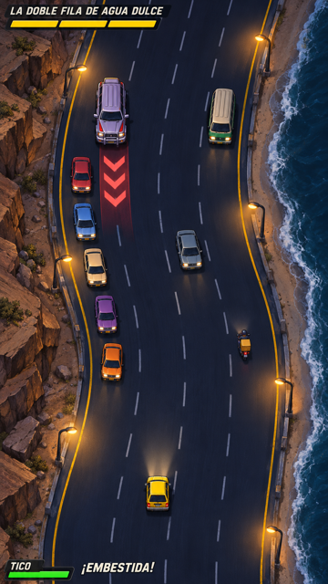

# Encargo de arte · Piloto de la Costa Verde

**Versión 1, 19 de noviembre de 2026.** Decisión del dueño del 19 de noviembre (ADR 0066): el arte se encarga afuera. Este documento es el encargo para quien lo produzca. Los campos marcados **[dueño]** los completa el dueño antes de enviarlo.

## 1. El juego en dos líneas
- **Limargeddon** es un arcade de acción vehicular para el navegador, pensado para jugar en el teléfono y en vertical. Se ve desde arriba y la pista baja.
- Un taxista informal con un Tico mejorable cruza distritos de Lima y enfrenta combis, policías, repartidores y jefes satíricos. Se puede jugar en https://tonmaived.github.io/limargeddon/.

## 2. Qué se encarga
Un **piloto en una sola etapa, la Costa Verde de noche**. Debe demostrar una mejora visible sobre el arte actual antes de extenderlo a las otras nueve etapas.

El arte actual se dibuja con código y se hornea como imagen. Tiene sombreado, relieve y acabado suave, pero se le nota el techo. El piloto interno de la Fase 10 es el punto de partida y hay que superarlo de forma visible, no igualarlo. Sobre todo tiene que verse que es Lima, no una costa cualquiera.

## 3. La Costa Verde de Lima
El piloto tiene que sentirse limeño a primera vista. Esto es lo que hay que saber del lugar.

- **Qué es.** La Costa Verde es la vía rápida que corre al pie de los acantilados de Lima, pegada al mar, desde Magdalena y Miraflores hasta Chorrillos. En el juego es el Circuito de Playas.
- **Hacia dónde se va.** El Tico baja hacia el sur, rumbo a Chorrillos. Por eso **el acantilado queda a la izquierda y el mar a la derecha**, como en la vida real.
- **El acantilado.** Es alto y de tierra con canto rodado, de color pardo grisáceo. En varios tramos está cubierto de **mallas antiderrumbe** sujetas con anclajes, y en otros tiene franjas de vegetación sembrada. Los derrumbes de piedras son un peligro real, sobre todo con los temblores. Las **bajadas**, como la Bajada Armendáriz y la Bajada Balta, son pistas que bajan del malecón cortando el acantilado y entran a la vía.
- **Arriba del acantilado** está el malecón, con edificios y barandas. Desde abajo, de noche, se ve como una línea de luces. En pantallas anchas, la columna más lejana del acantilado puede mostrar ese borde del malecón.
- **Las playas.** En Miraflores y Barranco son de piedras redondas, de canto rodado. Hacia Chorrillos aparece la arena. **Agua Dulce es una playa de arena en Chorrillos**, la más popular y llena del verano, con carpas y sombrillas de alquiler, salvavidas y vendedores ambulantes. De ahí sale el nombre del jefe.
- **El muelle de pescadores de Chorrillos.** Tiene botes de madera pintados de colores, redes y puestos de cebiche. Alrededor siempre hay gaviotas y pelícanos esperando su parte, y de ahí salen las bandadas del juego.
- **El Morro Solar.** Es el cerro que cierra la bahía al sur, detrás de Chorrillos. De noche tiene luces en la cima y se recorta contra el cielo. Más allá queda la playa La Herradura.
- **El mar de noche.** El Pacífico de Lima es frío y oscuro, con olas que revientan en espuma blanca sobre la orilla. Lejos se ven las luces de la bahía.
- **Quiénes andan por ahí.** Serenazgo de los distritos en camionetas, combis con el letrero de su ruta, como "CHORRILLOS", taxis, autos de aplicación, repartidores en moto y mototaxis que se escapan de los barrios de Chorrillos.
- **El heladero.** En las playas de Lima pasan heladeros empujando su carretilla y tocando una corneta. En el juego es "Don Frío", una marca inventada. No puede parecerse a ninguna marca real de helados, ni en colores ni en forma.

### La Doble Fila
- **El chiste.** Bañistas que llegan a Agua Dulce y estacionan en doble fila, "solo un ratito, voy a la playa y vuelvo", con las balizas prendidas como si eso lo hiciera legal.
- **Dónde va.** En la vida real **la doble fila se forma a la derecha del sentido de la pista**, en el carril pegado a la vereda de la playa, junto a los autos ya estacionados. El arte del jefe y de su fila tiene que pensarse para ese lado. En la pelea la fila se mueve por todos los carriles, pero su lugar natural, el de la fase "ESTACIONADOS", es la derecha.
- **La cabeza.** Es un SUV grande y nuevo, de esos que "son nuevos, cuidado". Si se inspira en una marca real, va como parodia ficticia, igual que el "Q6" de cuatro anillos con uno deformado del jefe de San Isidro.
- **Los autos de la fila.** Son autos de familia rumbo a la playa, con las balizas encendidas. Se pueden sugerir detalles de playa vistos desde arriba, como sombrillas, tablas o una conservadora sobre el techo y la maletera abierta.
- **Sus fases.** Se llaman "ESTACIONADOS", "FILA INDIA" y "AGUA DULCE". La última es la más agresiva, con bocinazos.

### Hitos para los costados
Igual que Miraflores, que tiene un hito cada tanto, los costados de la Costa Verde necesitan lugares que se reconozcan. Para el piloto se piden **cuatro hitos**, uno por tramo, que no se repitan seguidos.
- **Una bajada** que corta el acantilado, con su letrero. Los nombres de las calles los pone el juego.
- **El muelle de pescadores**, del lado del mar, con botes de colores y gaviotas.
- **Agua Dulce**, la arena con carpas cerradas, sombrillas plegadas y una torre de salvavidas.
- **El Morro Solar**, en la columna más lejana del acantilado, con luces en la cima.

## 4. Piezas del piloto
Todas van en vista cenital, con la luz desde arriba a la izquierda. Las medidas están en unidades lógicas, en una pantalla lógica de 360 × 640.

| Pieza | Medida lógica | Variantes |
|---|---|---|
| Tico del jugador (taxi amarillo) | 28 × 48 | sano, dañado, muy dañado; con parachoques de fierro y con blindaje lateral |
| Cabeza del jefe, "La Doble Fila", un SUV nuevo que encabeza la fila (ver la sección 3) | 34 × 60 | sano y dañado, con balizas |
| Autos de la fila del jefe, autos de familia rumbo a la playa | 28 × 44 | seis colores, sano y dañado, con balizas y algún detalle de playa en el techo |
| Tráfico de la etapa | serenazgo 30 × 52, combi 30 × 60, mototaxi 22 × 34, auto de aplicación 28 × 50, taxi 28 × 50, repartidor en moto 12 × 24 | sano y dañado |
| Acantilado (costado izquierdo) | tramos de 42 × 110 que se repiten hacia arriba | al menos cuatro tramos que encajen entre sí, con mallas antiderrumbe, anclajes, vegetación sembrada y canto rodado |
| Mar (costado derecho) | tramos de 42 × 110 | al menos tres tramos que encajen, con olas reventando y luces lejanas de la bahía en la columna más lejana |
| Orilla, entre la vereda y el mar | franja de 14 de ancho | dos tipos, canto rodado (Miraflores y Barranco) y arena (Chorrillos), cada uno con arena mojada o piedra mojada y espuma |
| Obstáculos | hueco en la pista (un carril, 22 de alto); barrera de bloqueo (dos carriles, 14 de alto) | sano y golpeado |
| Peligros | carretilla de helados "Don Frío" con su heladero, bandada de gaviotas (70 de ancho), piedras del derrumbe (canto rodado y tierra) | la carretilla con su toldo, las gaviotas en dos cuadros de aleteo |
| Hitos de los costados | tramos de 42 × 110, o dos tramos seguidos si el hito lo pide | los cuatro de la sección 3 |
| Bonus | seis íconos redondos de 24: turbo, cancha (maíz tostado), SOAT (el seguro obligatorio, como escudo), combi, picarón (el buñuelo limeño con miel), metro | uno por bonus |

Los textos de la pista, del HUD y los rótulos de techo, como "SERENAZGO" o "CHORRILLOS", los pone el juego. El arte no los lleva.

### Referencia visual del dueño

`limargeddon-costa-verde-360x640.png` es una referencia de ambiente: acantilado a la izquierda, mar y orilla a la derecha, postes con luz cálida y el aviso de embestida en rojo. No es un diseño cerrado. En esa imagen la doble fila va por la izquierda, y tiene que ir por la derecha, como dice la sección 3.

## 5. Requisitos técnicos
- **Formato.** PNG con fondo transparente, a 3 veces la medida lógica. Un Tico de 28 × 48 se entrega en 84 × 144. El juego lo dibuja a la resolución real de la pantalla, de 2 a 3 veces.
- **Archivo fuente.** Por capas, en el programa que se acuerde, para poder corregir colores y daños.
- **Tramos de costado.**
  - Repiten hacia arriba sin costura. Lo que cruza de un tramo al otro, como estratos o cables, tiene que coincidir en el borde.
  - Un mismo tramo no se puede notar repetido. Se combinan por semilla, así que con cuatro o más variantes basta.
  - La pista tiene curva. El juego corta cada tramo en franjas de 8 de alto y las corre enteras para seguir la curva. Una línea vertical larga dentro del tramo se vería en escalones, así que el borde del mar y la orilla van aparte (la franja de la orilla de la tabla) y el juego los dibuja siguiendo la curva.
- **Pantallas anchas.** En pantallas más anchas que 9:16 se ven más columnas de costado, hasta 90 de ancho por lado. Hacen falta tramos de mar adentro y de acantilado alto, que pueden ser más simples.
- **Noche.** El juego oscurece la pista y los costados con una capa al 62 por ciento, y se ve lo que iluminan los faros, los halos de los autos y los postes. El arte se entrega con sus colores de siempre, sin oscurecer, y tiene que leerse bajo esa capa.
- **Daño.** Hoy el juego deforma los vehículos por código según el daño. Como propuesta, para el piloto alcanzan tres estados (sano, dañado y muy dañado). El juego elige el estado y agrega humo y chispas.
- **Zonas de choque.** El dibujo tiene que caer dentro de la caja lógica de cada pieza. Con `?colisiones` en la dirección se ven las cajas sobre el dibujo.
- **Fluidez.** El cuadro tiene que dibujarse en menos de 20 ms en el percentil 95, en un teléfono de gama media. Hoy la Costa Verde da 16,8 ms en una computadora. Las imágenes cargan una sola vez, así que importa más su peso total que su cantidad. Como propuesta, el piloto completo debería pesar 4 MB o menos. Se ajusta con la dirección visual.

## 6. Lectura y tono
- **Las amenazas se leen primero.** El jefe, sus avisos, sus proyectiles, la carretilla, las gaviotas y el derrumbe tienen que distinguirse del fondo de un vistazo, en un teléfono. Ningún detalle de los costados puede competir con ellos.
- **Paleta.** Una noche de la costa limeña, con mar azul profundo, acantilado pardo de tierra y canto rodado, y luz cálida de postes de sodio. El asfalto es azul noche (`#1b2030`) con bordes amarillos.
- **Sátira.** Se burla del privilegio y de la mala conducción, nunca de rasgos raciales ni de clase. Las marcas reales van siempre como parodia ficticia. Por ejemplo, el SUV del jefe de San Isidro es un "Q6" con cuatro anillos y uno deformado. En el piloto no puede aparecer ningún logo real.

## 7. Entregas
1. **Dirección visual.** Una lámina de referencias y un cuadro de prueba de 360 × 640 con la pelea completa: el Tico, el jefe con su fila, tráfico, costados de noche y un aviso de embestida. El dueño la aprueba antes de seguir.
2. **Piloto.** Todas las piezas de la sección 3, con sus archivos fuente.
3. **Integración y prueba.** El equipo del juego integra las piezas y mide fluidez y lectura. Puede pedir una ronda de ajustes.

## 8. Criterio de aceptación
- En las capturas de la pelea, a 393 × 852, la mejora sobre el piloto interno se ve sin explicarla. Las páginas de comparación de `?graficos` muestran el antes.
- **Prueba con personas.** De seis a ocho personas juegan el piloto y la versión actual, alternando el orden. Se reportan los conteos junto con los porcentajes. La mayoría prefiere el piloto al jugar, no solo al mirar capturas, y lee las amenazas igual o mejor.
- Las amenazas se leen igual o mejor bajo la noche. El aviso de embestida sigue visible.
- En dos teléfonos representativos, con al menos diez minutos por versión, el percentil 95 queda en 20 ms o menos y el percentil 99 en 33,3 ms o menos.
- No hay escalones en el borde del mar ni un tramo repetido seguido.
- Alguien de Lima reconoce la Costa Verde sin que se lo digan: el acantilado con sus mallas, la playa, la doble fila a la derecha y al menos uno de los hitos.

## 9. Estimación y condiciones
- **Esfuerzo.** Como referencia interna, la séptima auditoría cita un rango previo de 5 a 9 jornadas para el piloto, que no se volvió a calcular. La mejora de todo el juego se estimó en 25 a 45 jornadas. Las dos cifras se confirman con quien produzca el arte, después de la dirección visual.
- **Quién lo produce:** [dueño]
- **Presupuesto y forma de pago:** [dueño]
- **Plazo de cada entrega:** [dueño]
- **Derechos.** El repositorio del juego es público, así que las imágenes integradas quedarán a la vista. Hay que acordar por escrito la cesión de derechos y si el artista puede mostrar el trabajo en su portafolio. [dueño]
- **Contacto y canal de entregas:** [dueño]

## 10. Para quien lo produzca
- **Para ver el juego.** El juego está en la dirección de la sección 1. La Costa Verde es la etapa 9. Para entrar sin ganar las anteriores, se agrega `?prueba` a la dirección y se elige el 9 en el menú.
- **Para ver el arte actual.** `?graficos` muestra la galería de vehículos, jefes, obstáculos y bonus, y el antes y el después de los costados.
- **Si algo de este documento no se puede cumplir,** conviene avisarlo antes de la dirección visual, no después.
